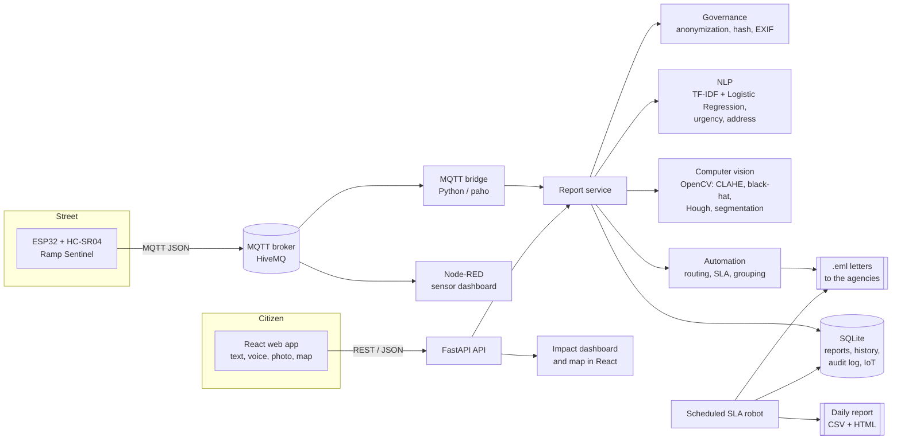
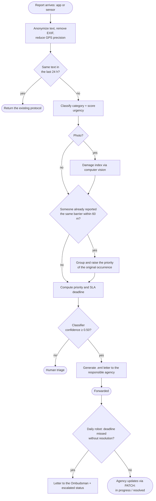
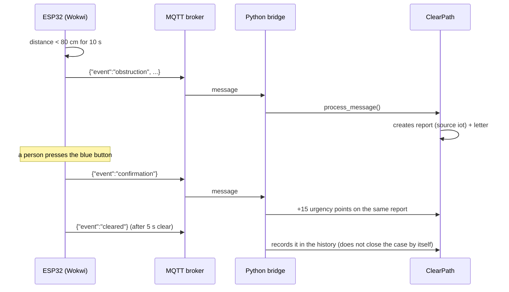

# ClearPath architecture

## Overview

## Automated process (simplified BPMN)

## Sequence: ramp sensor

## Code structure

| Module | Responsibility |
|---|---|
| `src/backend/clearpath/governance.py` | Anonymization (CPF, phone, e-mail, plate, name), pseudonymization, GPS precision |
| `src/backend/clearpath/nlp.py` | Preprocessing, classification, explainable urgency, address extraction |
| `src/backend/clearpath/vision.py` | OpenCV pipeline and damage index |
| `src/backend/clearpath/routing.py` | Priority, SLA, distance-based grouping (Haversine), letters, escalation |
| `src/backend/clearpath/service.py` | Orchestrates the pipeline; right to erasure; retention |
| `src/backend/clearpath/iot.py`, `mqtt_bridge.py` | Sensor events and MQTT subscription |
| `src/backend/clearpath/api.py` | REST API (FastAPI, Swagger at `/docs`) |
| `src/backend/scripts/` | Data generation, training, evaluation, SLA robot, demo data, sensor simulator |
| `src/frontend/` | React app (Vite, Leaflet, Recharts) |
| `src/iot/wokwi/` | ESP32 firmware + Wokwi circuit |
| `src/iot/node-red/` | Node-RED flow (sensor dashboard) |

## API endpoints

| Method | Route | Purpose |
|---|---|---|
| GET | `/api/health` | Checks that the API and the model are up |
| GET | `/api/categories` | Categories, responsible agency and legal basis |
| POST | `/api/classify` | Classification preview, nothing stored (used while typing) |
| POST | `/api/reports` | Creates a report (multipart: text, consent, lat, lon, photo) |
| GET | `/api/reports` | List (filters: category, status, priority) |
| GET | `/api/reports/{protocol}` | Details + timeline |
| PATCH | `/api/reports/{protocol}/status` | The agency updates the progress |
| DELETE | `/api/reports/{protocol}/data` | Right to erasure (LGPD art. 18) |
| POST | `/api/automation/escalate` | Triggers the escalation of missed deadlines |
| POST | `/api/iot/readings` | HTTP alternative to MQTT |
| GET | `/api/iot/devices` | Sensor states |
| GET | `/api/indicators` | Impact indicators (SDGs) |
