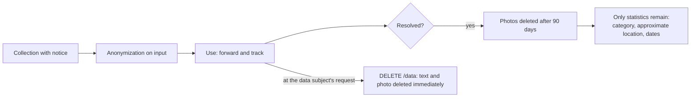

# Data governance and protection (LGPD)

LGPD is Brazil's General Data Protection Law (Law 13,709/2018).

## Principles applied

| Principle (LGPD art. 6) | How ClearPath applies it |
|---|---|
| Purpose | Data is used only to locate and fix the barrier; the notice is shown before submission |
| Necessity (minimization) | No sign-up, no name, CPF or contact details. Tracking is done with the protocol number |
| Transparency | Public timeline per protocol; the reason for the priority is explained to the citizen |
| Security | Anonymization before storage; salted hash; EXIF removed; reduced GPS precision |
| Prevention | Personal data written by mistake is detected and masked automatically |
| Accountability | The `audit_log` table records every processing step with its legal basis |

**Legal basis:** art. 7, III and art. 23 (execution of public policies by the public administration). Incidental personal data is anonymized (art. 12: anonymized data is not personal data).

## Data dictionary: `reports` table

| Field | Type | Description | Personal? | Treatment |
|---|---|---|---|---|
| protocol | text | `CP-YYYY-NNNNNN` | No | Generated |
| created_at / updated_at | ISO 8601 | Dates | No | |
| source | text | `citizen` or `iot` | No | |
| anonymized_text | text | Report with `[CPF]`, `[PHONE]`, `[EMAIL]`, `[PLATE]`, `[NAME]` | May contain residue (names without a trigger phrase) | Regex on input; erasable on request |
| text_hash | text(16) | SHA-256 + salt of the original text | Pseudonym | Never leaves the API; used only to detect duplicates |
| category / confidence / human_review | text / real / bool | Classifier output | No | |
| address | text | Extracted from the anonymized text | No (public street) | |
| lat / lon | real | Location of the barrier | Indirect | Rounded to 4 decimal places (~11 m) |
| urgency_points / urgency_reasons / priority | int / text / text | Explainable prioritization | No | |
| damage_index / damage_level | real / text | Computer vision output | No | |
| photo / photo_analysis | file | Photo re-encoded without EXIF + overlay | May contain a face or plate | Notice to the citizen; deleted on request or 90 days after resolution |
| group_root | text | Protocol of the original occurrence | No | |
| agency / deadline / status | text | Routing | No | |
| device | text | Sensor ID (if it came from IoT) | No | |

Other tables: `history` (status changes), `audit_log` (when, action, protocol, detail, legal basis), `iot_devices` and `iot_readings` (no personal data: the sensor measures distance and has no camera).

## Data quality

| Dimension | Control |
|---|---|
| Completeness | Text required (10 to 2,000 characters); latitude and longitude only together |
| Validity | Coordinates within ±90/±180; photo validated by OpenCV (up to 8 MB); only allowed status values |
| Uniqueness | The same text within 24 h returns the existing protocol; reports less than 60 m apart in the same category are grouped |
| Accuracy | Confidence below 0.50 goes to human triage instead of being forwarded automatically |
| Traceability | `history` and `audit_log` with date and time |

## Life cycle and retention

## Risks and mitigation (summary of a Data Protection Impact Assessment)

| Risk | Likelihood | Mitigation | Residual risk |
|---|---|---|---|
| Citizen writes third parties' data | Medium | Anonymization regex (tested in `tests/test_governance.py`) | Names without a trigger phrase ("John from the bakery") are not detected |
| Photo shows a face or a plate | Medium | Notice in the form; erasure on request | No automatic face blurring in this prototype |
| Re-identification by location | Low | GPS rounded to ~11 m; no device identifier | A barrier at someone's front door still points to the address |
| Misuse of the dashboard | Low | The dashboard only shows aggregated, anonymized data | In production: authentication for the agencies (PATCH) |
| Public MQTT broker | High (demo) | Messages contain no personal data | In production: own broker with TLS and per-device credentials |
