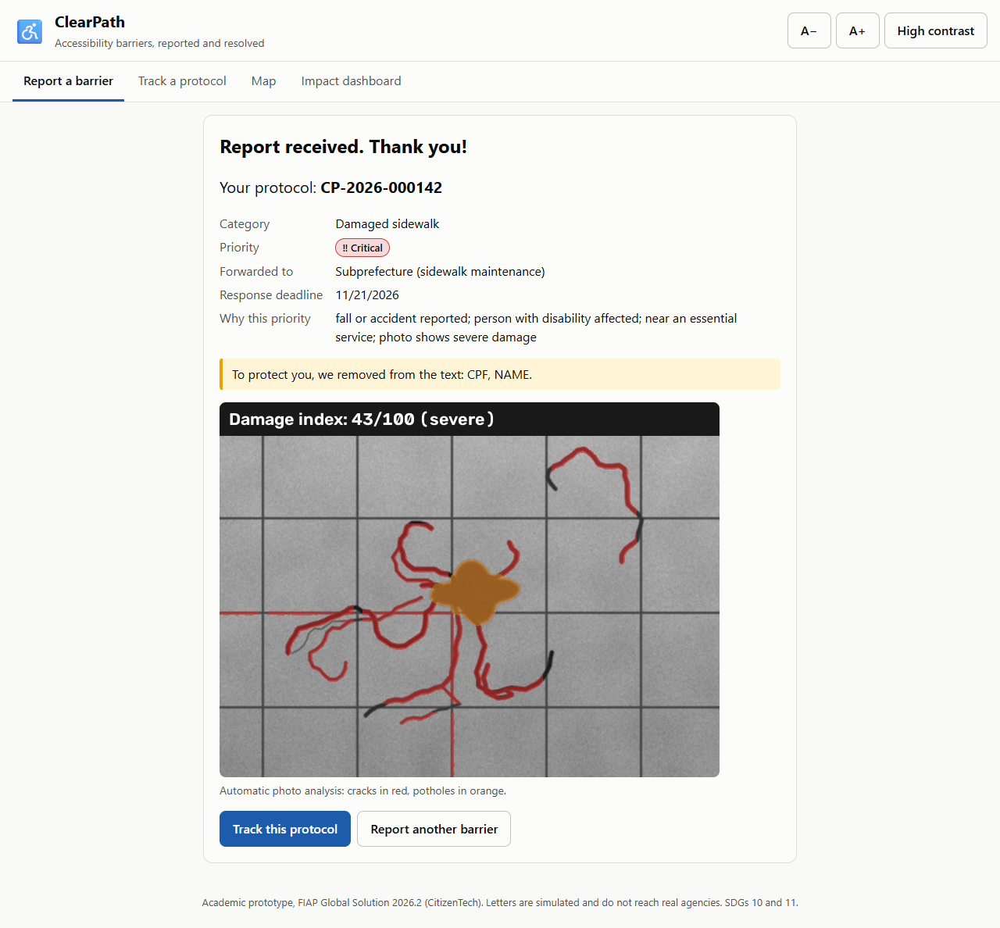
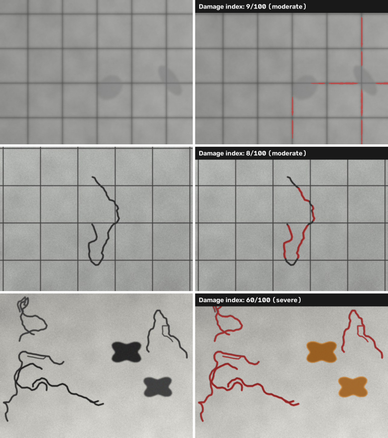

FIAP · Graduação em Inteligência Artificial · 2º ano

Global Solution 2026.2 · CitizenTech

<h1 class="title">ClearPath</h1>

Relatos de barreiras de acessibilidade urbana com encaminhamento automático ao órgão responsável

<table class="team">
<tr><th>Integrante</th><td>Vinicius Salvador</td></tr>
<tr><th>Tutor</th><td>Leonardo Ruiz Orabona</td></tr>
<tr><th>Coordenador</th><td>André Godoi</td></tr>
</table>

São Paulo, 2026

## 1. Introdução

### 1.1 Problema

Segundo o Censo 2022 do IBGE, o Brasil tem **14,4 milhões de pessoas com deficiência** (7,3% da população com 2 anos ou mais). Embora 84,0% dos moradores vivam em ruas com calçada, só **18,8%** vivem em ruas com calçada sem obstáculos, e **68,8%** (119,9 milhões) vivem em ruas sem rampa para cadeirantes.

Além da falta de infraestrutura, há um problema de processo. Quem encontra uma barreira precisa descobrir sozinho qual órgão é responsável, preencher formulários longos e esperar sem prazo nem retorno. Do lado do poder público, as reclamações chegam sem estrutura, repetidas e sem prioridade.

**Quem se beneficia:** pessoas com deficiência, idosos, gestantes e pessoas com carrinho de bebê. Indiretamente, também as equipes de manutenção, que passam a receber os casos já classificados, priorizados e localizados.

### 1.2 Objetivo

Desenvolver uma prova de conceito (POC) em que o cidadão relata a barreira com as próprias palavras, digitando ou falando, com foto e localização opcionais. O sistema faz o resto: protege os dados pessoais, classifica o relato, define a prioridade, agrupa relatos repetidos, gera o ofício ao órgão responsável e acompanha o prazo. Um sensor IoT detecta automaticamente carros parados em frente a rampas.

### 1.3 Objetivos de Desenvolvimento Sustentável (ODS)

| ODS | Meta | Contribuição |
|---|---|---|
| 11. Cidades e comunidades sustentáveis | 11.2 e 11.7 | Mapeia barreiras em calçadas, travessias e transporte e acelera o reparo |
| 10. Redução das desigualdades | 10.2 | Dá voz e prioridade a quem é mais afetado; interface acessível |
| 16. Paz, justiça e instituições eficazes | 16.6 | Prazos, escalonamento automático e histórico público por protocolo |

## 2. Desenvolvimento

### 2.1 Como funciona

1. O cidadão escreve ou dita o relato no app React e pode anexar uma foto e a localização.
2. A API (FastAPI) **anonimiza o texto antes de salvar qualquer coisa**, remove os metadados (EXIF) da foto e arredonda o GPS para cerca de 11 m.
3. O **PLN** classifica o relato em 6 categorias, extrai o endereço e calcula a urgência.
4. Se houver foto, a **visão computacional** calcula um índice de dano da calçada (0 a 100).
5. A **automação** agrupa relatos da mesma barreira (raio de 60 m), define prioridade e prazo e gera o ofício para o órgão. Se o classificador estiver inseguro, o relato vai para **triagem humana**.
6. Um **robô diário** escala à Ouvidoria os casos com prazo vencido.
7. O sensor **IoT** (ESP32 no Wokwi) publica via MQTT quando uma rampa fica bloqueada, e o sistema cria o relato sozinho.

| Disciplina | Onde aparece |
|---|---|
| Automação (RPA), Python e APIs | API FastAPI, roteamento, ofícios `.eml`, robô de prazos |
| Front-end React | Telas de relato, acompanhamento, mapa e painel |
| PLN | Pré-processamento, TF-IDF, Regressão Logística, urgência |
| Visão computacional | OpenCV: CLAHE, black-hat, Otsu, Hough, componentes conectados |
| IoT | ESP32 + sensor ultrassônico HC-SR04, MQTT, Node-RED |
| Governança de dados | Anonimização, auditoria, retenção, direito de exclusão (LGPD) |

### 2.2 Origem dos dados

| Conjunto | Origem | Natureza |
|---|---|---|
| Relatos de treino (1.320) | Gerador com 72 modelos de frase, sinônimos, erros de digitação e dados pessoais falsos | **Sintético** |
| Teste cego (60) | Frases escritas à parte, com vocabulário diferente dos modelos do gerador; não usadas no treino | Escrito manualmente |
| Imagens de calçada (45 de calibração + 45 de teste) | Gerador de textura de concreto, juntas, manchas, rachaduras e buracos | **Sintético** |
| Painel (141 relatos) | Relatos acima processados pelo sistema real, com datas e respostas dos órgãos **simuladas** | **Simulado** |

Não encontramos um conjunto público de reclamações de acessibilidade com licença clara. Por isso os dados foram gerados, o que também permitiu inserir dados pessoais falsos para testar a anonimização. O sistema e os dados estão em inglês.

### 2.3 Governança (LGPD)

O sistema não pede nome, CPF nem contato. Mesmo assim, as pessoas costumam escrever dados pessoais no texto, e por isso a anonimização é o primeiro passo:

[[code src/backend/clearpath/governance.py anonymize]]

### 2.4 Processamento de linguagem natural

Foram comparados três modelos. O escolhido combina TF-IDF de palavras e de caracteres, o que tolera erros de digitação, com Regressão Logística:

[[code src/backend/scripts/train_model.py candidates]]

### 2.5 Visão computacional

O índice de dano combina a área de rachaduras e a área de buracos. Os limiares (moderado ≥ 6, severo ≥ 27) foram escolhidos apenas no conjunto de calibração.

[[code src/backend/clearpath/vision.py analyze]]

### 2.6 Automação

[[code src/backend/clearpath/routing.py forward]]

### 2.7 IoT: sensor de rampa

O ESP32 mede a distância em frente à rampa. A máquina de estados só declara bloqueio depois de 10 s seguidos a menos de 80 cm, para não disparar com pedestres. Um botão permite que a pessoa confirme o bloqueio.

[[lines src/iot/wokwi/sketch.ino 156 186]]

### 2.8 Interface

O app tem ditado por voz, alto contraste, ajuste do tamanho da fonte e prioridade indicada por ícone, texto e cor.

## 3. Resultados

Todos os números abaixo foram obtidos executando o código do repositório.

**Classificação de relatos (PLN):**

| Modelo | F1 validação cruzada | F1 teste cego | Acurácia teste cego |
|---|---|---|---|
| Naive Bayes | 0,998 | 0,899 | 90,0% |
| **Regressão Logística (escolhido)** | **1,000** | **0,899** | **90,0%** |
| SVM linear calibrado | 1,000 | 0,881 | 88,3% |

A queda de 1,00 para 0,90 mostra que o gerador sintético é previsível; o teste cego é a estimativa honesta. Com o limiar de confiança de 0,50, 57 dos 60 relatos são encaminhados automaticamente com 91,2% de acerto, e os outros 3 vão para triagem humana.

**Visão computacional:** acurácia de **86,7%** nas 45 imagens de teste. Os erros ocorrem só entre classes vizinhas.

| Real \ Previsto | Sem dano | Moderado | Severo |
|---|---|---|---|
| Sem dano | **13** | 2 | 0 |
| Moderado | 3 | **12** | 0 |
| Severo | 0 | 1 | **14** |

**IoT:** o simulador em Python (`simulate_sensor.py`), que envia as mesmas mensagens do ESP32, publicou 4 mensagens no broker público HiveMQ, e o sistema recebeu todas: criou o relato, aumentou a prioridade com a confirmação do botão e registrou a liberação da rampa.

**Testes automatizados:** **39 testes passando** (`uv run pytest -v`; saída completa em `document/other/evidence/test_results.txt`).

| Arquivo | Testes | O que verifica |
|---|---|---|
| `test_governance.py` | 6 | Mascaramento de CPF, telefone, e-mail, placa e nome; arredondamento do GPS |
| `test_nlp.py` | 14 | Normalização, 6 categorias, triagem de texto sem sentido, urgência, endereço |
| `test_vision.py` | 5 | Calçada lisa, calçada severa, juntas ignoradas, remoção de EXIF |
| `test_api_flow.py` | 14 | Fluxo completo, agrupamento, triagem, escalonamento, exclusão (LGPD), IoT |

## 4. Conclusões

O ClearPath mostra, com um protótipo funcional e testado, que a IA pode tirar a burocracia de quem mais sofre com as barreiras urbanas: a pessoa relata com as próprias palavras e o sistema faz o resto. Cada disciplina resolve uma parte real do problema.

### 4.1 Limitações

- Os dados de treino são sintéticos; o desempenho com relatos reais ainda precisa ser medido.
- As imagens sintéticas são mais limpas que fotos reais. Por isso o índice de dano só reforça a prioridade e nunca decide sozinho.
- O firmware do ESP32 foi feito para simulação no Wokwi e não foi testado em hardware físico; o broker MQTT público não usa TLS.
- Os ofícios são gerados em arquivo e não são enviados aos órgãos.

### 4.2 Próximos passos

- Piloto com relatos reais, coletados com consentimento, para treinar e avaliar de novo o PLN.
- Rede neural treinada com fotos reais de calçadas.
- Desfoque automático de rostos e placas nas fotos.
- Integração com o canal 156 da prefeitura.

## 5. Referências

- BRASIL. Lei nº 13.146/2015 (Lei Brasileira de Inclusão).
- BRASIL. Lei nº 13.709/2018 (Lei Geral de Proteção de Dados).
- ABNT. NBR 9050:2020. Acessibilidade a edificações, mobiliário, espaços e equipamentos urbanos.
- IBGE. Censo Demográfico 2022: pessoas com deficiência. 2025.
- IBGE. Censo Demográfico 2022: características urbanísticas do entorno dos domicílios. 17 abr. 2025.
- ONU. Agenda 2030 para o Desenvolvimento Sustentável.

## 6. Links

| Item | Link |
|---|---|
| Vídeo de demonstração (YouTube, não listado) | https://youtu.be/rzzJpT7O9WU |
| Repositório GitHub (público) | https://github.com/viniciusslvdor/fiap-clearpath-urban-accessibility |
| Simulação do ESP32 no Wokwi | https://wokwi.com/projects/481174110278029313 |
